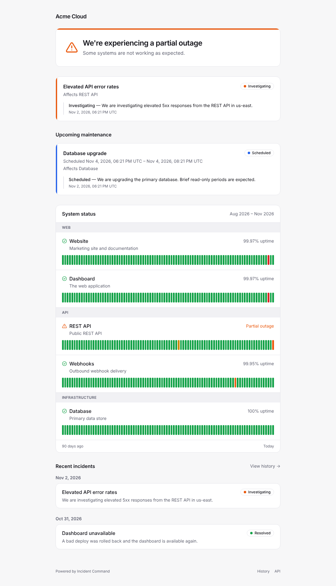
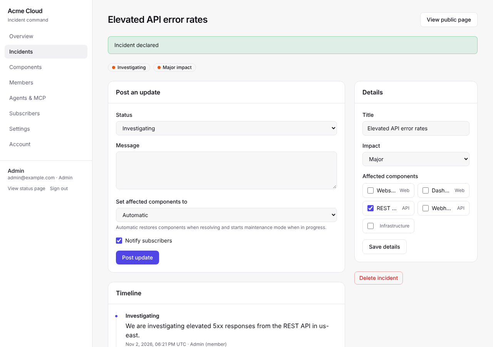
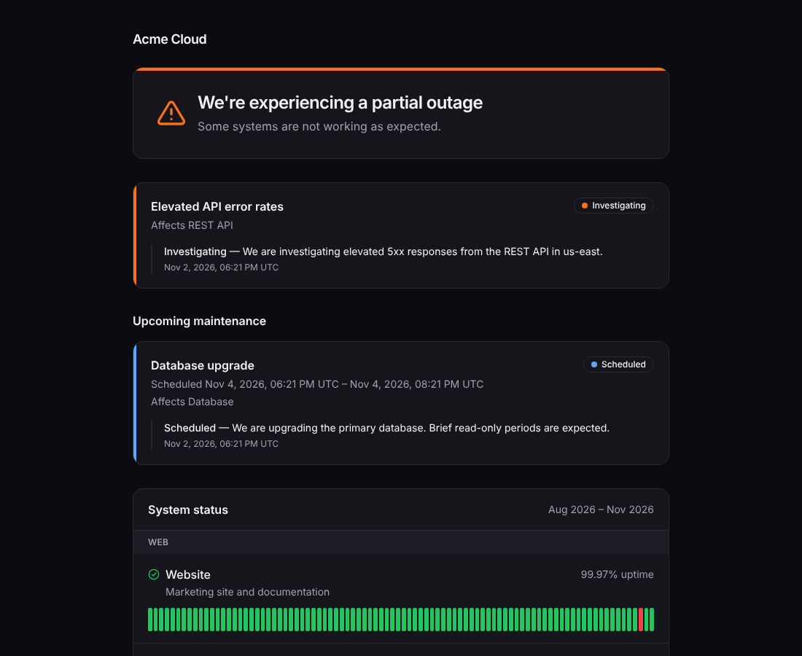

# Incident Command

> Open source incident command: a beautiful, skinnable status page, a management portal for your team, and an MCP server so AI agents can run the whole thing. Deploy it anywhere.

[](https://github.com/jaredwray/incident-command/actions/workflows/tests.yml)
[](LICENSE)



## Features

- **Status page:** overall status banner, active incidents, upcoming maintenance, grouped components with 90-day uptime bars, incident history, RSS feed and a public JSON API. Light and dark mode, mobile friendly.
- **MCP server:** a Streamable HTTP endpoint at `/api/mcp` with 27 role-scoped tools, so agents can declare and update incidents, change component status, schedule maintenance and (with an admin token) manage members, tokens, subscribers and settings. See [docs/mcp.md](docs/mcp.md).
- **Manage portal** at `/manage`: declare incidents, post updates, manage components, members (viewer/editor/admin), agent tokens, subscribers and branding.
- **Skinnable:** Tailwind CSS v4 on top of CSS design tokens. Pick a theme preset, set a brand color, logo and custom CSS from the portal, or add your own preset. See [docs/theming.md](docs/theming.md).
- **Runs anywhere:** Docker image for any container host, plus guides for Cloudflare, DigitalOcean, Google Cloud, AWS and Azure. See [docs/deployment.md](docs/deployment.md).
- **Pluggable storage:** PostgreSQL, MongoDB or in-memory, chosen from `DATABASE_URL`. Adding an adapter means implementing one small interface.
- **Keeps working when the database doesn't:** reads go through a [cacheable](https://cacheable.org) layer that never expires entries while the database is offline, so the status page keeps serving the last known state during an outage.
- **Notifications with [airhorn](https://airhorn.org):** signed webhooks (Slack and Discord compatible) and double opt-in email via SendGrid or Amazon SES.

<table>
<tr>
<td></td>
<td></td>
</tr>
</table>

## Quick start

Requires Node.js 24 and pnpm (`corepack enable`).

```bash
pnpm install
```

```bash
SEED_DEMO=true SETUP_TOKEN=replace-me pnpm dev
```

Open http://localhost:3000 for the status page and http://localhost:3000/manage/setup to create the first admin (use the `SETUP_TOKEN` above). Without `DATABASE_URL` the in-memory store is used, which is perfect for trying things out (data is lost on restart).

With Docker and Postgres:

```bash
docker compose up --build
```

## Deploy

| Platform                     | Guide                                                |
| ---------------------------- | ---------------------------------------------------- |
| Any container host / VPS     | [deploy/docker](deploy/docker/README.md)             |
| Cloudflare Workers           | [deploy/cloudflare](deploy/cloudflare/README.md)     |
| DigitalOcean App Platform    | [deploy/digitalocean](deploy/digitalocean/README.md) |
| Google Cloud Run             | [deploy/gcp](deploy/gcp/README.md)                   |
| AWS App Runner / ECS Fargate | [deploy/aws](deploy/aws/README.md)                   |
| Azure Container Apps         | [deploy/azure](deploy/azure/README.md)               |

Every option is configured with environment variables; the full reference is in [docs/deployment.md](docs/deployment.md) and [`.env.example`](.env.example). The essentials:

| Variable                       | Purpose                                                                                                           |
| ------------------------------ | ----------------------------------------------------------------------------------------------------------------- |
| `DATABASE_URL`                 | `postgres://…`, `mongodb://…` or unset for memory. Tables/indexes are created on boot.                            |
| `SITE_URL`                     | Public URL, used in notification links.                                                                           |
| `SETUP_TOKEN`                  | Required to create the first admin at `/manage/setup`. Without it, whoever reaches that page first becomes admin. |
| `CACHE_TTL`                    | How long cached reads are fresh (default `30s`).                                                                  |
| `EMAIL_FROM` + SendGrid or SES | Enables email subscriptions.                                                                                      |
| `WEBHOOK_SECRET`               | Signs webhook payloads (`x-incident-command-signature: sha256=…`).                                                |

Health check: `GET /api/health` returns `ok`, `degraded` (database offline, cached data still served) or `503` when the app cannot start.

## Connect an agent

Create a token in **Manage → Agents & MCP**, then:

```bash
claude mcp add --transport http incident-command https://status.example.com/api/mcp --header "Authorization: Bearer icmd_..."
```

Ask your agent something like _"We're seeing API errors in us-east, declare a major incident on the REST API and keep the status page updated"_. Tokens carry a role (viewer, editor or admin) and only see the tools that role allows. Details in [docs/mcp.md](docs/mcp.md).

## Architecture

```
            ┌──────────── Next.js (App Router) ────────────┐
 browsers ─▶│ status page · /manage portal · /api/v1 · RSS  │
 agents ───▶│ /api/mcp (MCP SDK, stateless Streamable HTTP) │
            └───────────────────────┬──────────────────────┘
                                    ▼
                      services (src/lib/services)
            incidents · components · uptime · members · sessions
               agents · subscribers · settings · status
                     │                         │
                     ▼                         ▼
          CachedStore (cacheable)        Notifier (airhorn)
     stale-while-offline read cache    webhooks · SendGrid · SES
                     │
                     ▼
     DocumentStore adapter: Postgres (jsonb) · MongoDB · memory
```

- **`src/lib/store`:** the `DocumentStore` interface (find/get/count/insert/update/delete with a small portable query language) and its adapters. A shared contract test suite (`test/store/contract.ts`) runs against every adapter, so a new adapter (SQLite, DynamoDB, Firestore, …) only has to pass it.
- **`src/lib/store/cached.ts`:** wraps any adapter. Cached reads are fresh for `CACHE_TTL`; after that they are refreshed from the database, and if the database is unreachable the last known value is served instead of an error. Writes go straight to the database and mark cached reads stale without discarding them. Only public status data is cached; sessions, members and tokens always hit the database.
- **`src/lib/services`:** all business logic and authorization (`viewer` < `editor` < `admin`), shared by the portal, the MCP server and the public pages.
- **`src/lib/notifications`:** an airhorn instance with a signed webhook provider and optional SendGrid (`@airhornjs/twilio`) or SES (`@airhornjs/aws`) email.

## Development

```bash
pnpm dev          # start the dev server
pnpm test         # lint (biome) + vitest with coverage
pnpm typecheck    # tsc
pnpm build        # production build (standalone output)
pnpm cf:preview   # build and run on Cloudflare workerd locally
```

The test suite enforces **100% line, branch, function and statement coverage** of `src/`. Postgres adapter tests run against a real in-process Postgres ([PGlite](https://pglite.dev)) and Mongo tests against [mongodb-memory-server](https://github.com/typegoose/mongodb-memory-server), so no external services are needed. The MCP server is tested end to end with the official MCP client.

## License

[MIT](LICENSE) © Jared Wray
